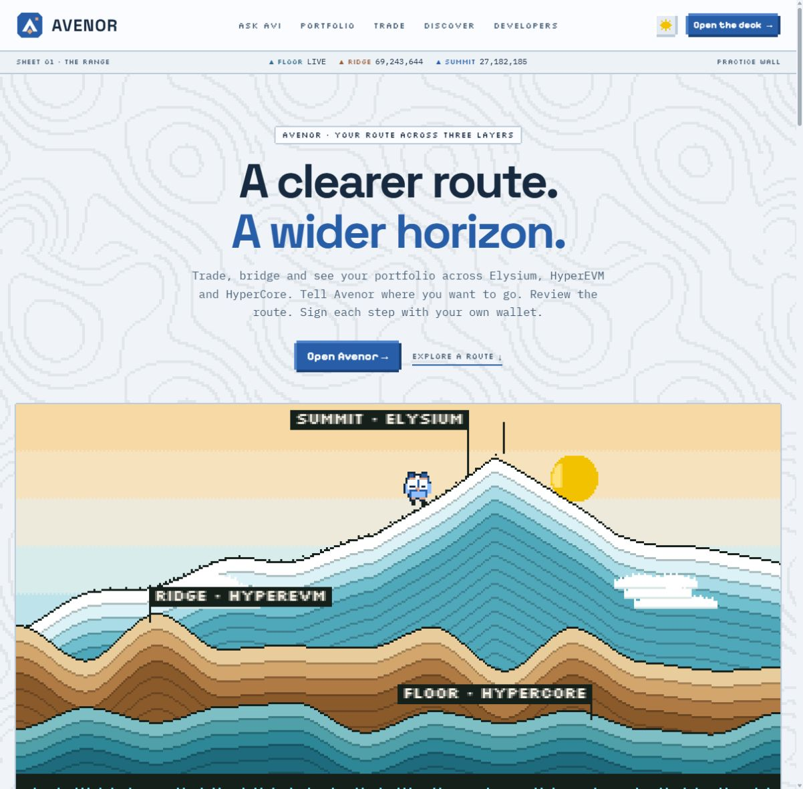
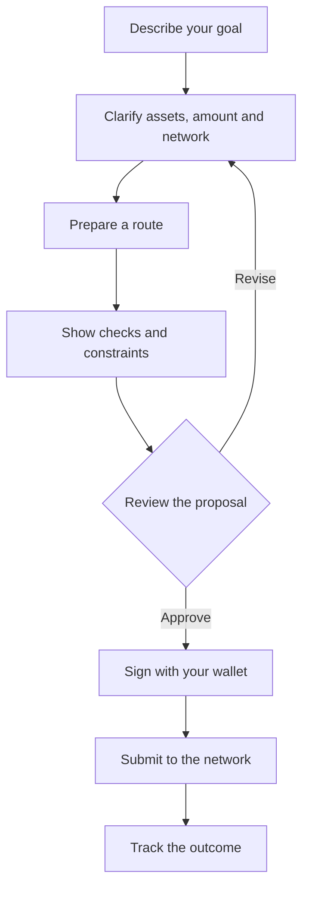
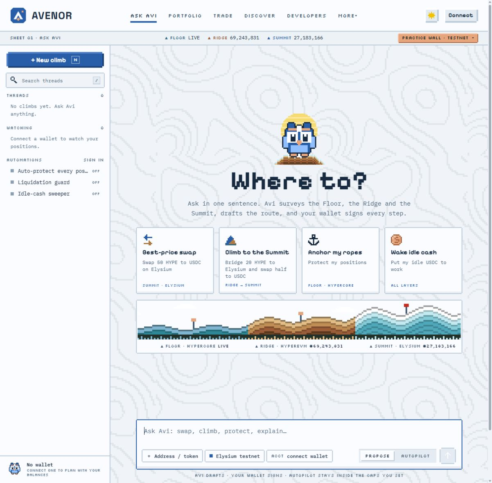
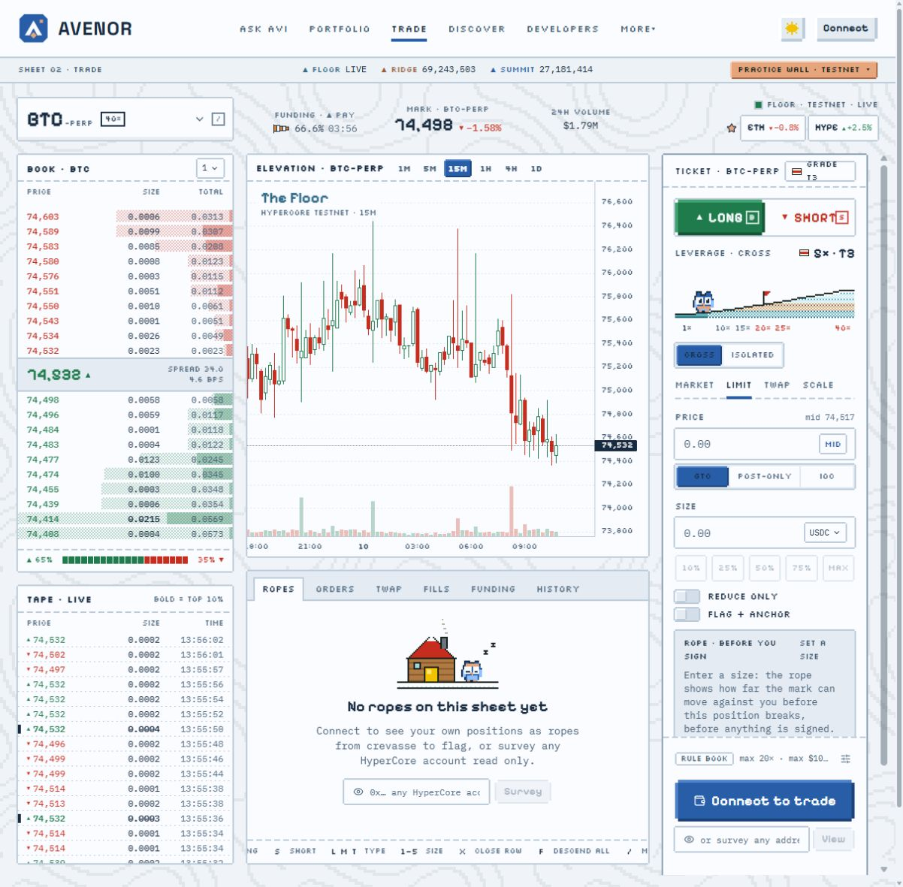
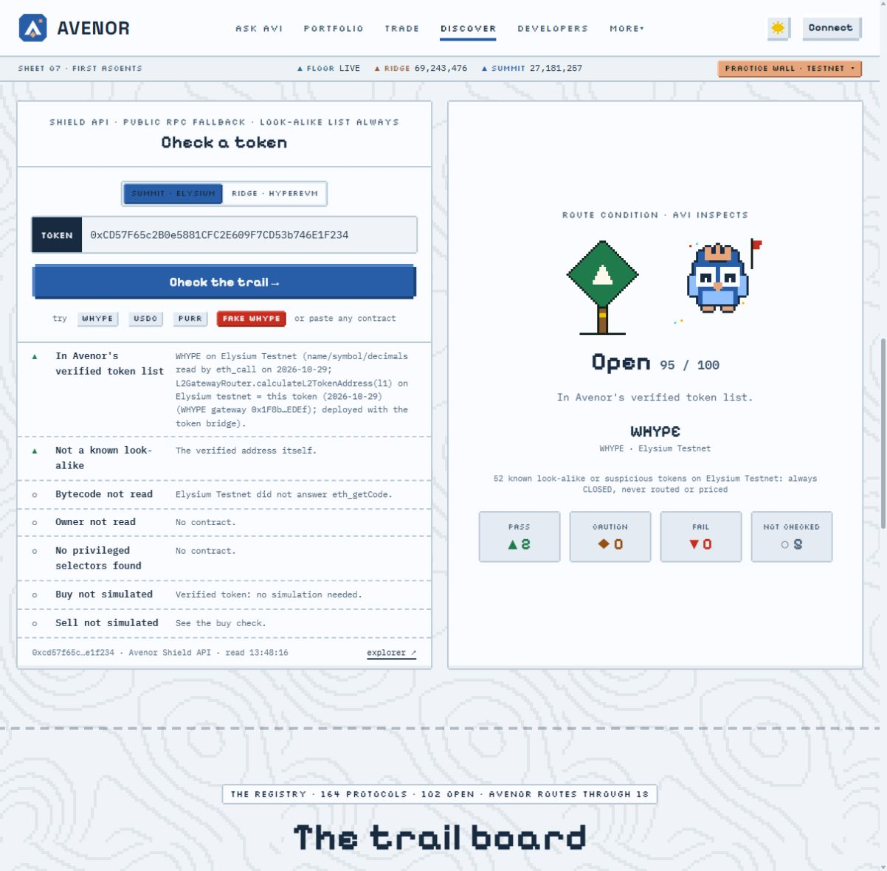

# AVENOR

### A clearer route. A wider horizon.

Trade, bridge and understand your portfolio 
across **Elysium, HyperEVM and HyperCore**.

**One workspace. Three layers. Guided by Avi.**

[Overview](#overview) · [Features](#features) · [How it works](#how-it-works) · [Use cases](#use-cases) · [Screenshots](#screenshots) · [Project status](#status)

## From a goal to a clear plan

**Avenor is a workspace for managing crypto assets across connected networks.** Describe what you want to do, review a proposed route, and approve the required operations with your wallet. Trading, portfolio views and token research stay within the same interface.

Avi, the blue-and-copper pixel owl, is your guide. Its changing expressions make loading, progress, completion and warnings easier to recognize at a glance.

This repository is a **product showcase** with documentation and screenshots. The images were captured from the running local application on **November 10, 2026**, without a personal wallet connected. Application source code and deployment files are not distributed here.

### Why Avenor exists

| The problem | The approach | What you gain |
| :--- | :--- | :--- |
| Assets and actions are spread across networks | A shared workspace with clear network labels | Context about where an asset is and where it is going |
| A single goal can require several operations | A route broken into reviewable steps | A visible sequence before you approve anything |
| Raw figures can hide the state of a position | Charts, portfolio terrain and visual status cues | A more readable view of exposure and changes |
| A token name alone does not identify a contract | Address checks with individual findings | A view of known matches, warnings and missing information |

## What you can explore

| Area | Your goal | What the interface provides |
| :--- | :--- | :--- |
| [**Ask Avi**](#screen-avi) | Start with an intention | A conversation, suggested tasks, proposals and thread history |
| [**Trade**](#screen-trade) | Inspect a market and prepare an order | A chart, order book, order parameters and position panels |
| **Portfolio** | Understand your holdings and exposure | A view across layers, portfolio terrain and a market-shock visualization |
| [**Discover / Shield**](#screen-discover) | Research a token or protocol | Contract-address checks, individual findings and a protocol directory |
| **Routes and tracking** | Prepare a swap or cross-network transfer | Route steps, confirmations and execution states |

### Three layers, one map

| Avenor landmark | Environment | Role in the workspace |
| :--- | :--- | :--- |
| **Floor** | HyperCore | Trading markets, orders and positions |
| **Ridge** | HyperEVM | EVM applications and asset operations |
| **Summit** | Elysium | Another layer of the route, with bridges and applications |

The mountain metaphor organizes the interface. Altitude does not indicate an investment's safety or expected return.

## How it works

**For example:** choose an asset swap → specify the amount and network → inspect the proposal → approve in your wallet → follow the transaction status. A proposal is a plan; it is not a completed transaction.

Standard operations require wallet approval. Delegated keys and automated actions are separate modes with explicitly granted permissions.

## Choose a use case

Expand a scenario to see the intended workflow. These walkthroughs describe the interface; they are not records of executed trades.

<strong>I want to start with a simple task</strong>

1. Open **Ask Avi** and choose a prompt for a swap, bridge or portfolio task.
2. Specify the assets, amount and network. The current interface offers English and Turkish input.
3. Review the response and resolve any missing parameters.
4. Connect a wallet when balances or a signature are needed.
5. Check the proposal before approval, then follow its status after submission.

[See Ask Avi ↓](#screen-avi)

<strong>I want to understand the trading screen</strong>

**Trade** places the chart, order book and order form together. Choose a market, then inspect the order type and parameters. **Connect to trade** indicates that a wallet is required to continue.

The screenshot shows testnet mode. Prices, volumes and changes are a historical interface snapshot, not current quotes or trading results.

[See the trading screen ↓](#screen-trade)

<strong>I want to inspect a token</strong>

1. Select the network in **Discover** and enter a contract address.
2. Read the individual findings: known-list matches, similar addresses and available contract data.
3. Check the **Not checked** count. Missing information is not a successful check.

The screenshot includes unavailable data. Its **95/100** indicator is an internal interface score, not an audit, a safety probability or a guarantee that a token can be bought or sold.

[See token research ↓](#screen-discover)

<strong>I am new to these terms</strong>

| Term | Plain-language meaning |
| :--- | :--- |
| Wallet | A tool for controlling an address and approving operations |
| Swap | Exchanging one asset for another |
| Bridge | A mechanism for moving assets between networks |
| Order | A request to buy or sell with specified parameters |
| Perpetual | A derivative contract without an expiry date |
| Testnet | A network used to test interactions |
| Signature | Approval of a particular message or operation using a wallet key |

## See the workspace

Actual application screenshots. Click any image to open the full-size version.

### 01 · Ask Avi — your starting point

Tasks and history sit on the left; the request field and suggested directions sit in the center. Avi helps you read the current state of the workspace.

### 02 · Trade — market context beside the order

<strong>Open the trading screen</strong>

The chart shows price movement, the order book shows bids and asks, and the right-hand panel holds order parameters. Positions and orders appear below. No wallet is connected in this screenshot.

### 03 · Discover — findings you can inspect

<strong>Open token research</strong>

The left panel explains the findings. The right panel summarizes completed and skipped checks. The visible address belongs to the displayed token contract, not a personal wallet.

## Project status

| Question | Current status |
| :--- | :--- |
| Is this only a set of mockups? | No. The screenshots come from a running local application. |
| What is demonstrated here? | The home page, Ask Avi, trading interface and token research in testnet mode. |
| Were transactions executed for this showcase? | No wallet was connected and no transactions were submitted. |
| Is there a hosted public demo? | A public Avenor application URL has not been provided. This repository is a product overview. |
| Is it production-ready? | Production readiness is not claimed. Function availability depends on network connectivity, services and configuration. |
| What has been checked? | Individual interface checks and builds have passed. The full verification suite has a known blocker: a missing external research dataset required by one test. |
| Has this version been independently audited? | No independent security audit was performed for this version. |

## About this repository

This showcase contains **the README, third-party notices and four screenshots**. Application source code, configurations, credentials, build artifacts and development history are excluded.

Applicable copyright and permission notices are preserved in [THIRD_PARTY_NOTICES.md](THIRD_PARTY_NOTICES.md). Public documentation and images can be viewed and copied; withholding the application source does not make public materials technically uncopyable.

[↑ Back to top](#avenor)
